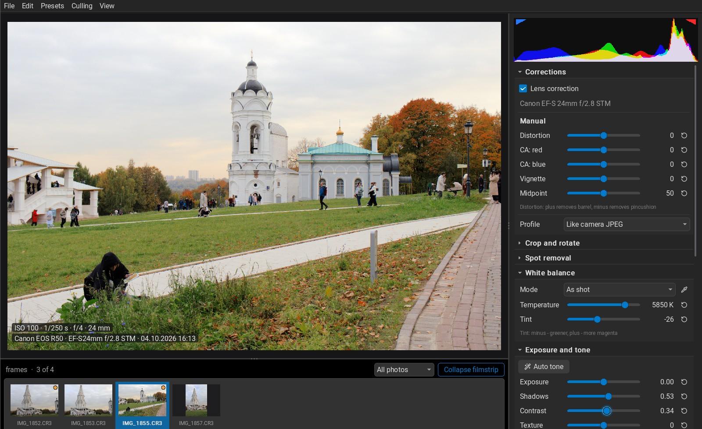
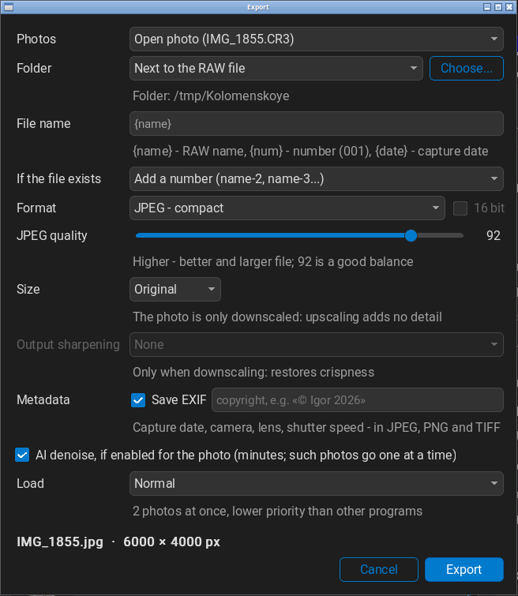
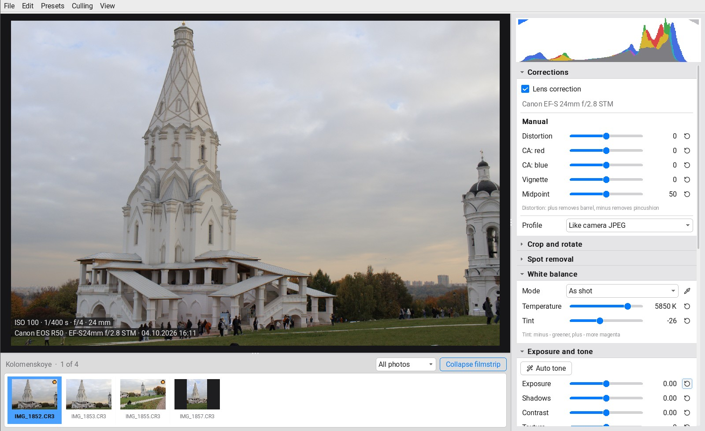

# vraw

[English](README.md) | [Русский](README.ru.md) | **Deutsch** | [Français](README.fr.md) | [Español](README.es.md) | [Nederlands](README.nl.md) | [Português](README.pt.md) | [Polski](README.pl.md)

Ein kostenloser RAW-Entwickler für Linux und Windows. Öffnet Canon CR3
und alle anderen Formate, die LibRaw versteht, bearbeitet
nicht-destruktiv und exportiert nach JPEG, PNG, TIFF, BMP, QOI oder GIF.
Portabel: entpacken und starten, nichts zu installieren.

## Download

Das aktuelle Archiv gibt es unter [Releases](../../releases/latest):

- **Linux x86_64** — `vraw-linux-x86_64.tar.gz`. Beliebig entpacken und
  `vraw/vraw` starten. Benötigt glibc 2.39 oder neuer (Ubuntu 24.04,
  Linux Mint 22, aktuelle Fedora und Arch).
- **Windows x64** — `vraw-windows-x86_64.zip`. Entpacken und `vraw.exe`
  starten. Die KI-Rauschentfernung benötigt das
  [Microsoft Visual C++ Redistributable](https://learn.microsoft.com/cpp/windows/latest-supported-vc-redist).
  Die Windows-Version ist experimentell: bisher nur unter Wine getestet.

Einstellungen, Presets und das KI-Modell liegen neben dem Programm – der
Ordner kann also auf einem USB-Stick leben.

Sonst muss nichts installiert werden: Alle Bibliotheken sind im Archiv.
Die einzige Ausnahme ist das Visual C++ Redistributable unter Windows, und
auch nur für die KI-Rauschentfernung; ohne es funktioniert alles andere.

## Systemanforderungen

| | Minimum | Empfohlen |
|---|---|---|
| System | Linux x86_64 mit glibc 2.39+ (X11 oder Wayland); Windows 10 64 Bit | dasselbe |
| Prozessor | beliebiger 64-Bit-x86 | 4+ Kerne (Pipeline und Export nutzen alle Kerne) |
| Arbeitsspeicher | 4 GB | 8 GB oder mehr |
| Festplatte | 300 MB für das Programm | plus Platz für die Fotos |
| Bildschirm | 1280×720 | 1920×1080 |

Eine Grafikkarte ist nicht nötig. Die KI-Rauschentfernung läuft auf dem
Prozessor und ist langsam: Auf einem Intel Core i5-1235U (10 Kerne) mit
16 GB RAM dauert die Vorschau etwa 4 Minuten, ein volles 24-MP-Bild etwa
16 Minuten. Alle anderen Werkzeuge reagieren sofort.

## Funktionen

**Bearbeitung**
- Nicht-destruktiv: Die RAW-Datei wird nie verändert. Änderungen und der
  komplette Verlauf werden automatisch in einer Sidecar-Datei neben dem
  Foto gespeichert.
- Belichtung, Kontrast, Tiefen/Lichter, Schwarz- und Weißpunkt,
  Tonwert-Equalizer, Textur, Klarheit, Dunst entfernen, Dynamik und
  Sättigung.
- Weißabgleich, Kurven RGB/R/G/B, HSL-Equalizer, Schwarzweiß,
  Color Grading.
- „Wie Kamera-JPEG“: Tonwerte und Sättigung werden an das im selben Bild
  eingebettete JPEG angeglichen.
- Auto-Ton (Strg+U).
- Objektivkorrektur aus der lensfun-Datenbank: Vignettierung,
  Verzeichnung, chromatische Aberration.
- Zuschneiden und Ausrichten, Perspektivkorrektur, Flecken entfernen,
  Masken.
- Rauschreduzierung, Schärfen, Vignette und Filmkorn.
- **KI-Rauschentfernung** mit dem neuronalen Netz SCUNet (mitgeliefert,
  funktioniert offline): entfernt Rauschen und erhält Details. Läuft im
  Hintergrund mit Fortschrittsanzeige und Abbruch.

**Ansicht und Auswahl**
- Filmstreifen mit allen RAW-Dateien des Ordners; benachbarte Bilder
  werden im Voraus entwickelt, Blättern mit ←/→ ist daher sofort.
- Bewertungen 0–5, Markierungen „ausgewählt/abgelehnt“, Filter;
  abgelehnte Bilder wandern in den Papierkorb des Systems.
- Vorher/Nachher: `\` gedrückt halten oder geteilte Ansicht (Y).
- Zwei Bilder nebeneinander vergleichen (C) mit gemeinsamem Zoom.
- Warnung vor Über- und Unterbelichtung, RGB-Histogramm,
  Aufnahmedaten (ISO, Verschlusszeit, Blende, Objektiv), Minikarte bei
  100 %.
- Vollbildmodus, 15 Designs (darunter macOS und Mac OS 9 Platinum).

**Stapelverarbeitung und Export**
- Einstellungen kopieren und einfügen (mit Auswahl der Gruppen) – in ein
  oder viele Bilder.
- Presets: speichern, umbenennen, importieren und exportieren.
- Export des geöffneten Bildes, der ausgewählten, des gefilterten
  Filmstreifens oder des ganzen Ordners; Dateinamen-Vorlagen (`{name}`,
  `{num}`, `{date}`), Verkleinern, JPEG-Qualität.
- EXIF und ein sRGB-ICC-Profil in JPEG, PNG und TIFF.
- TIFF und PNG wahlweise mit 16 Bit.

**Oberfläche in 31 Sprachen**, standardmäßig in der Systemsprache. Alle
Tastenkürzel lassen sich neu belegen.

## Screenshots

## Mit Claude Code gemacht

vraw ist per Vibe-Coding entstanden: gemeinsam mit
[Claude Code](https://claude.com/claude-code), dem KI-Programmierassistenten
von Anthropic. Das Programm ist in [V](https://vlang.io) auf meiner
eigenen GUI-Bibliothek vgui geschrieben, mit eigener Tonwert-Pipeline;
LibRaw übernimmt nur das Demosaicing.

## Lizenz

MIT, siehe [LICENSE](LICENSE). Der Quellcode wird nicht veröffentlicht.
Die in den Archiven enthaltenen Fremdkomponenten (LibRaw, lensfun, SDL3,
ONNX Runtime, SCUNet und andere) stehen unter ihren eigenen Lizenzen:
siehe `THIRD_PARTY.md` und den Ordner `licenses/` im Archiv.
